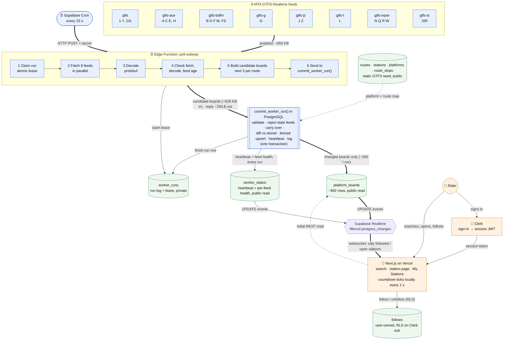

# Step 3 — Plan the Data Flow (HEADWAY)

**Status: approved architecture (2026-11-03), revised with review feedback, and amended in Step 4 prep (board comparison moved into PostgreSQL; see §3.6 for the benchmark).** Nothing in this document has been built yet. There are no tables, functions, Cron jobs, or Realtime subscriptions.
Inputs: the Assignment 5 PDF, [Step 1 findings](../step1/STEP1_LIVE_SOURCE.md), and the Supabase docs checked on 2026-11-03.

---

## 1. Data-flow diagram



**Legend.** 🔵 Blue = **scheduled background work**. It runs every 15 s whether or not anyone is watching. 🟠 Orange = **user-initiated**: signing in, searching, following, opening a page. 🟢 Green = data stored in Postgres.
Solid arrows carry data. Dotted arrows are reads the worker uses for its decisions.

### The two loops, in words
| | Scheduled loop (every 15 s) | User loop (on demand) |
|---|---|---|
| Starts with | pg_cron fires `pg_net.http_post` | A rider opens Headway |
| Path | Cron → Edge Function → claim lease → MTA × 8 → decode → feed checks → candidate boards (next 3 per route) → **`commit_worker_run` in Postgres**: validate → diff → fenced upsert of changed boards + `worker_status` + `worker_runs`, one transaction | Clerk sign-in → page reads boards + stations → subscribes to Realtime for the visible platforms → follows/unfollows a station |
| Writes | Only changed `platform_boards` rows, 1 `worker_status` update, 1 `worker_runs` row | Only the user's own `follows` rows |
| Who it acts as | The worker's secret key, server-side only. RLS is bypassed, so the worker can write public tables | The user's Clerk session token. RLS checks `sub` |

---

## 2. Database plan

**Eight tables** in `public`:

| Group | Tables |
|---|---|
| Static reference (4) | `routes`, `stations`, `platforms`, `route_stops` |
| Live data (1) | `platform_boards` |
| Worker health (2) | `worker_status` (heartbeat), `worker_runs` (execution log, also used as the run lock) |
| User-owned (1) | `follows` |

RLS is on for every table: the project's existing `rls_auto_enable` event trigger enables it automatically, and each table still gets explicit policies.
The worker writes through **three SQL functions** (§3.3), never directly to tables: `claim_worker_run`, `commit_worker_run`, `fail_worker_run`, plus the helper `board_changed` used inside the commit. They aren't tables, but they are part of the schema. **The worker never reads boards or status:** comparing new boards with stored ones happens inside `commit_worker_run`, so stored data never leaves the database (egress, §3.6).
Static tables are loaded once from MTA static GTFS (`stops.txt`, `routes.txt`, `trips.txt`/`stop_times.txt`, `Stations.csv`) by a seed script in Step 4.

### 2.1 `routes`: public, static (29 rows)
| Column | Type | Notes |
|---|---|---|
| `route_id` | `text` **PK** | `1`, `6X`, `A`, `GS`, `FS`, `H`, `SI`, … (matches the realtime `route_id`) |
| `short_name` | `text` | Bullet label: `S` for all three shuttles, `SIR` |
| `long_name` | `text` | "Broadway - 7 Avenue Local" |
| `color`, `text_color` | `text` | Hex from `routes.txt` |
| `feed` | `text` | Which of the 8 feeds carries it, e.g. `gtfs-bdfm` |
| `sort_order` | `int` | Display order |

### 2.2 `stations`: public, static (445 rows, one per station complex)
What a rider calls "a station". Times Sq–42 St is one row, not five.
| Column | Type | Notes |
|---|---|---|
| `station_id` | `int` **PK** | MTA `Complex ID` from `Stations.csv` (e.g. `611`) |
| `name` | `text` | "Times Sq-42 St" |
| `borough` | `text` | `M`, `Bk`, `Q`, `Bx`, `SI` |
| `routes` | `text[]` | Daytime routes for chips and search ("1 2 3 7 A C E N Q R W S") |
| `lat`, `lon` | `double precision` | For a possible "near me" feature later |
| `search_text` | `text` | Lower-cased name + aliases. Indexed with trigram (`pg_trgm`) for typo-tolerant search |

### 2.3 `platforms`: public, static (~992 rows, one per direction of each GTFS stop)
The join point between realtime data and stations.
| Column | Type | Notes |
|---|---|---|
| `stop_id` | `text` **PK** | `127S`, exactly as it appears in realtime |
| `parent_stop_id` | `text` | `127` |
| `station_id` | `int` **FK → stations** | Complex `611` |
| `direction` | `char(1)` | `N` / `S`, from the stop suffix (Step 1: the suffix is always present; the NYCT direction field isn't) |
| `direction_label` | `text` | "Downtown & Brooklyn", from `Stations.csv`. Never show "N/S" to riders |
| `line_name` | `text` | "Broadway - 7Av", used to tell apart the platforms within one complex |

Unique: `(parent_stop_id, direction)`. Index: `station_id`.

### 2.4 `route_stops`: public, static (lets riders "find a line")
| Column | Type | Notes |
|---|---|---|
| `route_id` | `text` **FK → routes** | |
| `station_id` | `int` **FK → stations** | |
| `seq` | `int` | Order along the line's most common pattern |

PK `(route_id, station_id)`. Derived once from the static `stop_times.txt`.

### 2.5 `platform_boards`: public, written by the worker, **Realtime: yes**
One row per platform. This is the only high-churn table.
| Column | Type | Notes |
|---|---|---|
| `stop_id` | `text` **PK, FK → platforms** | |
| `station_id` | `int` **FK → stations** | Copied from `platforms` so the page can filter subscriptions without a join |
| `trains` | `jsonb` | The **next 3 trains of every route** serving this platform, merged and sorted by `eta`. Average 4.6 entries, max 12 in Step 1 data. Each entry: `{trip_id, route_id, eta, kind, headsign, live, feed, carried}` (see below) |
| `run_id` | `bigint` | The `worker_runs.id` that last wrote this row. This is the **fencing token** (§3.3): a row is only overwritten by a newer run |
| `updated_at` | `timestamptz` | When this row's content last changed (not when it was last checked) |

Train entry fields:
* `eta`: absolute epoch seconds.
* `kind`: `arr` or `dep`. Origin terminals often only have a departure time.
* `headsign`: the trip's final stop name.
* `live`: NYCT `is_assigned`. `false` means only the schedule.
* `feed`: which of the 8 feeds it came from, so the UI can match it to feed health.
* `carried`: `true` if the train was copied from the stored board because its feed was unhealthy this run.

**Why per route (full coverage).** At a shared platform such as 125 St southbound (A B C D), the next 3 trains overall can all be A trains. Storing the next 3 *per route* guarantees every line that serves a platform has its own arrivals, while the **default view still shows just the first 3 rows** of the merged list. The UI derives both views from the same array with no extra queries:
* **Default:** "Next trains", the first 3 of `trains`.
* **Line filter** (route chips on the station page, or arriving from a Line page): that route's 3 trains.

Cost, measured on Step 1 data (62 s gap): **678 boards changed with per-route vs 626 with overall-only**, about 8% more writes.

**Change rule (the core of "save only what changed").** Compare the newly built board with the **stored** row, entry by entry in `eta` order. Write it if **any** of these hold:

| Kind of change | Detected when | Threshold |
|---|---|---|
| Train identity / order | Ordered list of `trip_id`s differs (a new train appears, one leaves, two swap) | **Immediate** |
| Arrival / departure | A train **departs** (its entry disappears), or it crosses into the "Arriving" window (`eta − now` goes under 60 s in one version but not the other), or `kind` flips between `arr` and `dep` | **Immediate** |
| Assigned / live status | `live` flips | **Immediate** |
| Prediction disappears | Entry removed, or the board goes from non-empty to `[]` | **Immediate** |
| Route / destination | `route_id` or `headsign` differs for the same `trip_id` | **Immediate** |
| Feed health of a train | `carried` flips, so riders know a time is no longer live. Trains are marked carried only from a feed's **2nd consecutive** failed run, so a single 15 s blip doesn't rewrite hundreds of boards | **Immediate** (once marked) |
| ETA fluctuation | Same trip, `|eta_new − eta_stored| ≥ 30 s` | **30 s** |

Everything else (±1–29 s jitter on the same trains in the same order) is skipped. Comparing against the stored value means small drift adds up and is eventually written. The page counts down locally from `eta`, so time passing never needs a write.
The rule lives in one SQL function, `board_changed(stored, new, now)`, called by `commit_worker_run`. It is the single source of truth: the Deno test (§3.5) checks the same cases against it.
Measured (§3.6) with live snapshots taken exactly 15 s apart: **302 of 975 boards change per run.** The breakdown is 218 for ETA ≥ 30 s, 56 for identity/order, 14 for `live`, and 7 for arriving-window. ETA revisions of 30 s or more are genuinely frequent in MTA data. A 60 s threshold would give 170 per run, but barely changes what a rider receives (8 vs 9 messages per run at three hubs), so 30 s stays.
Index: `station_id`.

### 2.6 `worker_status`: public, 1 row, **Realtime: yes**
The page's heartbeat. It's updated on every run, including runs where nothing changed. This is how the page tells "unchanged data" apart from "dead worker".
| Column | Type | Notes |
|---|---|---|
| `id` | `smallint` **PK** = 1 | `check (id = 1)` |
| `last_run_id` | `bigint` | Newest run that committed. A status update from an older run is rejected (fencing) |
| `last_run_at` | `timestamptz` | When the last run finished, set by DB `now()` |
| `last_success_at` | `timestamptz` | When the last run with ≥ 1 healthy feed committed |
| `last_status` | `text` | `ok` (8/8 healthy) · `partial` (1–7) · `error` (0, or an exception) |
| `last_error` | `text` | Short reason for `error`/`partial`, shown in logs (not to riders) |
| `feeds` | `jsonb` | **Per-feed health**, one key per feed (example below). This is what keeps a successful worker run from hiding a bad MTA feed |
| `boards_changed` | `int` | From the last run |

Per-feed health in `feeds`:
```json
"gtfs-ace": {
  "ok": true,                      // passed every validation check this run
  "feed_ts": "2026-11-03T17:35:21Z", // MTA's own header.timestamp (when MTA generated the data)
  "fetched_at": "…",               // when the worker received it
  "last_ok_at": "…",               // last run where this feed was healthy
  "fail_streak": 0,                // consecutive unhealthy runs (computed in SQL from the stored value)
  "reason": null                   // worker: "timeout" | "http_503" | "decode" | "feed_too_old"
                                   // SQL:    "not_newer" | "unmapped_spike" | "empty"
}
```

### 2.7 `worker_runs`: private log + run lock, not in Realtime
One row per run, as the assignment requires. The row with `status = 'running'` is also the **lease** that keeps runs from overlapping (§3.3).
| Column | Type | Notes |
|---|---|---|
| `id` | `bigint identity` **PK** | Always increasing, so it doubles as the fencing token |
| `started_at`, `finished_at` | `timestamptz` | `finished_at` null = still running or crashed |
| `lease_expires_at` | `timestamptz` | `started_at + 30 s`. After this, another run may take over |
| `status` | `text` | `running` · `ok` · `partial` · `error` · `superseded` (lease lost before commit). A refused claim writes no row; see §3.3 |
| `feeds_ok`, `feeds_failed` | `int` | Out of 8 |
| `trains_seen`, `boards_changed`, `stops_unmapped` | `int` | Counts for logs and the class demo |
| `duration_ms` | `int` | |
| `error` | `text` | First error message, truncated |

Indexes: `started_at desc`, and a **partial unique index** `on worker_runs ((true)) where status = 'running'`. That index makes it impossible for the database to hold two running runs at once, which backs up the lock function at the constraint level.
Retention: a daily SQL Cron job deletes rows older than 3 days. At 15 s that's ~5,760 rows a day, so ~17k rows are kept.

### 2.8 `follows`: user-owned, RLS-protected, not in Realtime
| Column | Type | Notes |
|---|---|---|
| `user_id` | `text` | Clerk user ID (`user_…`), defaults to `auth.jwt()->>'sub'` |
| `station_id` | `int` **FK → stations** | Riders follow a station; the page shows all its platforms |
| `created_at` | `timestamptz` | |

PK `(user_id, station_id)`, which also blocks duplicate follows. Limit: 12 follows per user, enforced by a trigger, so the Realtime filter stays under its 100-value cap.

### 2.9 RLS and Realtime summary
| Table | anon | authenticated | Worker (secret key) | Realtime |
|---|---|---|---|---|
| routes, stations, platforms, route_stops | SELECT `true` | SELECT `true` | write (seed) | no |
| platform_boards | SELECT `true` | SELECT `true` | via `commit_worker_run` only | **yes** |
| worker_status | SELECT `true` | SELECT `true` | via `commit_worker_run` / `fail_worker_run` | **yes** |
| worker_runs | none | none | via functions only | no |
| follows | none | SELECT/INSERT/DELETE where `user_id = (select auth.jwt()->>'sub')` | none | no |

`follows` policies (planned):
```sql
-- using AND with check, for select / insert / delete, "to authenticated" only
(select auth.jwt()->>'sub') is not null and user_id = (select auth.jwt()->>'sub')
```
The three worker functions are `security definer` with `set search_path = ''`, and `execute` is granted **only to `service_role`**: revoked from `public`, `anon`, and `authenticated`. Browsers can never call them.
Also planned: revoke `execute` on `public.rls_auto_enable()` from `anon` and `authenticated`. Step 2's security advisor flagged it.

---

## 3. Worker and Cron plan

### 3.1 Schedule
* **Every 15 s** via `cron.schedule('poll-subway', '15 seconds', $$ select net.http_post(...) $$)`.
  The URL and the worker secret are read from **Vault**, never written into SQL or the repo.
* Free-tier math: 172,800 Edge Function calls a month = **35% of 500k**, leaving room for testing and manual runs. 10 s (52%) also fits if we want to match the PDF's suggested starting point. **The interval is one number, so it's easy to change.**
* A **separate daily SQL Cron job** (no Edge Function call) prunes `worker_runs`.

### 3.2 Each run, step by step
| # | Step | Details |
|---|---|---|
| 0 | **Authenticate the caller** | Reject unless the `x-worker-secret` header matches the function secret. Strangers can't trigger MTA fetches |
| 1 | **Claim the run (atomic)** | RPC `claim_worker_run()` returns a new `run_id` or `null`. See §3.3. `null` means another live run holds the lease: record nothing more and exit |
| 2 | **Fetch** | All 8 feeds in parallel with `Promise.allSettled`, 6 s timeout each (`AbortController`), one quick retry on a network error. **Hard run budget of 12 s**, aborted well inside the 30 s lease and the 150 s wall clock |
| 3 | **Decode** | `npm:gtfs-realtime-bindings` (protobufjs). Step 1 measured ~5–13 ms for all 8 feeds, far below the 2 s CPU limit |
| 4 | **Check each feed (worker side)** | A feed is reported `ok: false` if the fetch fails or times out (`timeout`, `http_5xx`), decode throws (`decode`), or `now − header.timestamp > 90 s`, meaning MTA stopped updating although HTTP said 200 (`feed_too_old`). The worker reports **every** feed with its `header.timestamp`. The checks that need stored or static data run in SQL (step 6) |
| 5 | **Build candidate boards** | For **healthy** feeds only: `eta = arrival ?? departure` (`kind` records which); skip `eta < now − 30 s` and `eta > now + 90 min`; group by `stop_id` (merging A/B/C/D at 125 St); keep the **next 3 per route**; `headsign` = the trip's last stop. Stop IDs are sent as-is, and SQL decides which are unknown |
| 6 | **Commit (atomic, in PostgreSQL)** | One RPC, `commit_worker_run(run_id, feeds, boards)`. Request ≈ 628 KB (data going *into* the database isn't egress), reply ≈ 130–230 B. In **one transaction** it: **validates** the input; **rejects** feeds whose timestamp is older than the last accepted one (`not_newer`), whose stop IDs are > 20% unknown (`unmapped_spike`), or that report `ok` but give 0 valid trains (`empty`); **carries over** stored trains for rejected feeds; **rebuilds** next-3-per-route boards; **diffs** them against stored boards with `board_changed`; **upserts only changed boards**, fenced by `run_id`; updates `worker_status` (heartbeat + per-feed health); and finishes the `worker_runs` row. See §3.3 |
| — | On any exception | `fail_worker_run(run_id, error)` marks the run `error` and updates `worker_status.last_status = 'error'`, so the page can show **Down**. Boards are left untouched |

### 3.3 Concurrency: atomic claim, fencing, and no stale overwrites
pg_net fires Cron requests asynchronously, so two invocations *can* overlap: a slow run, a manual test call, or a retry. Four layers prevent duplicate work and stale overwrites.

**① Atomic claim: one running run at a time.**
```sql
-- claim_worker_run(): security definer, execute granted to service_role only
-- Serialize all claimers on one transaction-scoped advisory lock (released at commit)
perform pg_advisory_xact_lock(hashtext('headway.poll-subway'));
-- Expire a crashed run whose lease ran out
update worker_runs set status = 'superseded', finished_at = now()
 where status = 'running' and lease_expires_at < now();
-- If a live run still holds the lease, refuse
if exists (select 1 from worker_runs where status = 'running') then return null; end if;
insert into worker_runs (started_at, lease_expires_at, status)
values (now(), now() + interval '30 seconds', 'running')
returning id;            -- the run_id / fencing token
```
* The advisory lock makes check-then-insert atomic: concurrent claimers queue up and run it one at a time.
* The **partial unique index** (`where status = 'running'`) is a second guarantee at the constraint level. Even a buggy caller can't create two running rows.
* `skipped` attempts aren't logged as rows. They only return `null`, which keeps the log readable. The function's return is visible in the Edge Function logs.

**② Fencing token: an old run can never overwrite a newer one.**
`run_id` is always increasing. In `commit_worker_run`:
```sql
-- the lease must still be ours
update worker_runs set status = $status, finished_at = now(), ...
 where id = $run_id and status = 'running'
-- if 0 rows were updated, the lease was lost: raise 'superseded' and roll back everything

insert into platform_boards (stop_id, station_id, trains, run_id, updated_at)
select ... from jsonb_to_recordset($changed_boards) ...
on conflict (stop_id) do update
  set trains = excluded.trains, run_id = excluded.run_id, updated_at = now()
  where platform_boards.run_id < excluded.run_id;   -- newer run wins, always

update worker_status set ... where id = 1 and last_run_id < $run_id;
```
Suppose run 41 hangs past its lease, run 42 claims and commits, and then run 41 wakes up. Run 41's commit finds its `worker_runs` row already marked `superseded`, raises, and rolls back. Even if it got past that check, the `run_id <` guards would reject every row.

**③ Per-feed timestamp check, inside the commit: never go backwards in MTA time.**
The worker accepts a feed only if its `header.timestamp` is ≥ the `feed_ts` stored in `worker_status.feeds` (step 4). An older payload, such as a cached copy, is treated as unhealthy (`not_newer`), so its older predictions can't replace newer ones.

**Input validation in `commit_worker_run`** (from security definer code, executable only by `service_role`):
| Level | Check | On failure |
|---|---|---|
| Call | `run_id` present; `feeds` is an object with **exactly** the 8 feed keys; `boards` is an array of ≤ 2,000 entries | Exception: the whole call is rolled back, and the worker then calls `fail_worker_run` |
| Lease | The run row is `running` (locked `for update`) and its lease hasn't expired | Exception `superseded`, rolled back |
| Feed | `ok`, `feed_ts` present and ≥ stored; ≤ 20% unknown stops; ≥ 1 valid train | Feed rejected: its trains are carried, `reason` recorded |
| Train | `stop_id` exists in `platforms`; `route_id` exists **and belongs to the claimed feed** (`routes.feed`); `eta` is a number within [now − 30 s, now + 90 min]; `kind` ∈ {arr, dep}; `live` is boolean; `trip_id` is 1–64 chars; `headsign` truncated to 100 | Train dropped and counted in `trains_rejected` |
| Board | Duplicate `trip_id` per platform → keep one; > 3 per route → keep the soonest 3 | Normalized, not an error |

**④ Idempotent writes.**
Boards are keyed by `stop_id` and only overwritten by a newer `run_id`. Re-running the same input produces an empty diff. A retried request is harmless.

### 3.4 Failure handling
| Situation | Behavior | Page shows |
|---|---|---|
| One feed fails a single run (timeout / 5xx / too old / not newer) | Run `partial`; `feeds[feed].ok = false`. Its stored trains are kept **unchanged** (not yet marked carried) and only expired ones drop. Measured: **78** board writes for a one-run blip in the largest feed | **Partial** on affected lines |
| Same feed fails a 2nd run in a row | Its trains get `carried: true`. Measured: **488** writes once, then normal; **357** writes when it recovers | **Partial**, carried times greyed |
| A feed keeps failing (`fail_streak` ≥ 4, ~60 s) | Same, and its carried trains expire naturally as their ETAs pass | Affected lines: **Down** |
| All 8 feeds unhealthy, or code throws | Run `error` (via commit or `fail_worker_run`). Boards are never blanked: measured **0 of 975** emptied even when all feeds reported `ok` with only invalid trains | **Down** |
| MTA changes a feed's stop IDs (format change) | > 20% unknown stops, so that feed is rejected as `unmapped_spike`; other feeds are unaffected (measured) | **Partial / Down** for those lines |
| Function crashes / times out before commit | Its transaction never happened, so nothing is half-written. The lease expires after 30 s, and the next claim marks it `superseded` | **Stale** after 60 s without a heartbeat, then recovers on its own |
| Two invocations overlap | Second claim returns `null` and exits | Nothing visible |
| Old run wakes up after a newer one committed | Commit rejected by fencing, rolled back | Nothing visible |
| Cron stopped / project paused | No heartbeat | **Stale** |
| Database unreachable from the worker | Can't write status either | **Stale** (silence, never false-Fresh) |

### 3.5 Test (required by the PDF)
`deno test` runs the **real worker code and the real migration SQL** on saved MTA responses. There is no network and no Supabase involved: the SQL runs in an in-memory PGlite Postgres, the same way the §3.6 benchmark did.
1. **Worker side (steps 3–5)** on the saved Step 1 fixtures (`docs/step1/evidence/raw/A_*.pb`, `C_*.pb`) with a fixed "now":
   * Decode succeeds.
   * 125 St southbound has A, B, C, and D entries (next 3 per route).
   * Trains outside [now − 30 s, now + 90 min] are excluded.
   * A corrupted or too-old feed is reported `ok: false`.
2. **Commit side (step 6)**: apply the migration to PGlite, seed platforms and routes, then commit fixture A followed by fixture C:
   * L `072350_L..N` at `L03N` (+486 s) is written.
   * A train shifted only ±1–5 s in the same order is **not** written.
   * Each immediate rule in `board_changed` triggers on its own: identity, order, departure, arriving window, `live`, `kind`, headsign, `carried`.
   * Unknown stops and route/feed mismatches are rejected and counted.
   * A one-run feed failure keeps trains unmarked; a second failure marks them carried; nothing is ever blanked.
   * Identical replay writes 0.
3. **Concurrency (SQL)**:
   * Two `claim_worker_run()` calls in a row: the second returns `null`.
   * An expired lease is superseded.
   * A commit from an older `run_id` raises `superseded` and changes no rows.
   * An invalid `feeds` object raises `invalid_input`.

### 3.6 Benchmark of the PostgreSQL-side comparison (2026-11-03)
**Method.** The prototype functions (`claim_worker_run`, `commit_worker_run`, `board_changed`) were replayed against **five real snapshots** in one transaction that was rolled back: Step 1's A/B/C, plus two new live snapshots, D and E, taken **exactly 15 s apart** at 18:30:55 and 18:31:10 UTC. The run used all 992 real platforms and 29 routes.
It ran in PGlite (PostgreSQL compiled to WebAssembly), because the 1 MB script is too large for the MCP SQL tool. WebAssembly is slower than Supabase's native Postgres, so the timings are an upper bound.

| Scenario | Status | Boards written | Commit time |
|---|---|---|---|
| Initial fill | ok | 975 (all, once) | 87 ms |
| **Live, 15 s after previous run** | ok | **302** | 88 ms |
| Step 1 gaps: 62 s / 264 s | ok | 717 / 922 | 83–99 ms |
| Largest feed (`gtfs`) fails 1 run | partial | 78 | 76 ms |
| …fails a 2nd run (trains marked carried) | partial | 488 | 75 ms |
| …recovers | ok | 357 | 81 ms |
| Identical replay | ok | **0** | 81 ms |
| L feed stop IDs renamed (format change) | partial (`gtfs-l` rejected) | 17 | 79 ms |
| Older payload replayed late | error (all `not_newer`) | 48 (expired trains dropped) | 55 ms |
| Second claim while a run is live | `null` | — | — |
| Stale run commits after a newer run | `superseded`, rolled back | 0 | — |
| Feeds object missing feeds | `invalid_input`, rolled back | 0 | — |
| All feeds "ok" but only invalid trains | error, all 8 `empty` | 0 boards emptied | — |

**Egress (5 GB/month free).**
| | Old plan (worker reads boards) | New plan (diff in SQL) |
|---|---|---|
| Per run | 837 KB read | ~150 B reply + ~100 B claim |
| Per month at 15 s | **~148 GB** ❌ | **~45 MB** ✅ |

Realtime egress is separate: about 3 KB per run per open tab (2.1 board rows of ~0.9 KB, plus a ~1.2 KB heartbeat), so ~0.75 MB per tab-hour.

**Writes.** ~302 board upserts per run (~1.7M a day) on a ~992-row table, plus 1 status update and 2 run-log writes. That's tiny for Postgres; autovacuum handles the dead rows. `cron.job_run_details` and `worker_runs` are pruned daily.

**Realtime messages (2M/month, 100/s free).**
* Measured over a 15 s gap, a rider following **3 random stations** gets **2.1 board messages per run on average (95th percentile: 5)**, plus 1 heartbeat. That's about 720 messages per tab-hour, so **the 2M monthly quota covers ~2,800 tab-hours**.
* A hub-heavy rider (Times Sq + 125 St + Union Sq, 18 platforms) gets 9 per run.
* **Per-second cap:** each run's changes are delivered in a burst. About 30 simultaneous typical tabs (~3 messages each) stays under 100/s.
* **Mitigations:** the page unsubscribes while its tab is hidden and after 30 minutes idle; there are never table-wide subscriptions; the REST fallback covers reconnects.
* Grouping messages per station instead of per platform would save only ~30%, so platform rows stay.

**Not yet measured, to check after the first deploy:** whether a ~628 KB RPC request body is accepted by Supabase's API gateway (if not, the payload has a 2–3× smaller array form); whether MTA serves Supabase's cloud IPs as it served my laptop; and native-Postgres commit time.

---

## 4. Realtime plan

### 4.1 What the browser subscribes to
| Page | Initial read (REST) | Realtime channel |
|---|---|---|
| **My Stations** (signed in) | `follows` → their stations → those platforms' boards | `platform_boards`, `event: UPDATE`, `filter: station_id=in.(611,…)`. At most 12 values, under the 100 cap |
| **Station page** (anyone) | That station's platforms + boards | Same, with `station_id=eq.611` |
| **Every page** | `worker_status` | `worker_status` UPDATE, about 1 message per run |

* The page subscribes only while visible and unsubscribes on route change or tab close. There are never table-wide subscriptions.
* Messages per open tab ≈ (changed boards at its stations per run) + 1 heartbeat. Measured: **~3 per 15 s for a rider following 3 stations**, so 2M per month ≈ 2,800 tab-hours (§3.6). The page **pauses its subscriptions while the tab is hidden** and after 30 minutes idle, then refetches on return. Free limits: 2M per month and 100 per second.
* **Fallback if this gets large:** switch to Broadcast-from-database, one topic per station. It isn't needed at classroom scale.

### 4.2 Clerk + Supabase
* The Supabase client in the browser uses `accessToken: () => session.getToken()` from Clerk, the officially supported third-party auth. Realtime uses the same token.
* RLS on `follows` reads the Clerk user ID from `auth.jwt()->>'sub'`. Public tables need no token.
* **One-time dashboard setup (you):** Clerk dashboard → *Connect with Supabase*, then Supabase → Authentication → Third-party Auth → add Clerk. Without this, every follow insert fails RLS.

### 4.3 Countdown between events
* The board stores absolute `eta`.
* The browser keeps a 1 s `setInterval` that re-renders "Arriving" (< 60 s) or "4 min" from `eta − now`.
* `now` is corrected by a **clock offset** measured once from the HTTP `Date` header of the initial REST read, so a wrong laptop clock can't skew countdowns or freshness.
* A Realtime event only replaces that platform's `trains` array.
* When a train's ETA passes `now − 30 s`, the UI drops it locally, even before the worker's next write.

### 4.4 Freshness: three independent signals
A healthy worker must not hide a bad MTA feed, and a dead websocket must not look like healthy data. So each station view combines three separate measurements:

| Signal | Source | Healthy when |
|---|---|---|
| **A. Worker heartbeat** | `worker_status.last_success_at`, `last_status` | `now − last_success_at ≤ 60 s` (≤ 4 missed 15 s runs) and `last_status ≠ 'error'` |
| **B. Feed health, per feed this station needs** | `worker_status.feeds[f]` for each `f` serving the station's routes (`routes.feed`) | `ok = true` **and** `now − feed_ts ≤ 90 s`. MTA's own timestamp, not the worker's, so an MTA feed frozen while still returning 200 is caught |
| **C. Realtime connection** | The channel status in the browser | `SUBSCRIBED`, and the last heartbeat event arrived ≤ 30 s ago (2 runs). A silently dead socket is caught even without an error event |

While C is unhealthy, the page **falls back to a REST read of `worker_status` every 15 s**. That keeps A and B accurate, so a dropped connection is never mistaken for a dead worker, and the reverse.

### 4.5 The six states, with precedence
Evaluated per station card, top row first (the first match wins). The connection banner is shown in addition to the data state.

| # | State | Condition | What the rider sees |
|---|---|---|---|
| 1 | **Loading** | Initial REST read of boards + status not returned yet | Skeleton rows, never fake numbers |
| 2 | **Down** | A says `last_status = 'error'`, **or** every feed this station needs is unhealthy in B, **or** a needed feed has been unhealthy ≥ 60 s (`fail_streak ≥ 4`) and none of the station's trains are live | "No live data for these lines right now." Carried times hidden. Shows "MTA feed not responding" or "Headway's updater failed" depending on which signal failed |
| 3 | **Stale** | A: `now − last_success_at > 60 s` (the worker is silent: Cron stopped, crash, or DB unreachable) | Board muted, "Last updated 3 min ago, times may be off." Countdown continues but is visibly marked |
| 4 | **Partial** | A healthy, but **some** of this station's feeds are unhealthy or older than 90 s in B | Healthy lines look normal. Affected lines are marked "A C E: delayed data, last live 1 min ago", and their `carried` trains are greyed |
| 5 | **Fresh** | A healthy **and** every needed feed healthy **and** C healthy | "Live · updated 8 s ago", ticking from `last_success_at`. Trains changed by the last event briefly highlight |
| — | **Reconnecting** (banner) | C unhealthy: `CLOSED`, `TIMED_OUT`, `CHANNEL_ERROR`, or no heartbeat event for 30 s | Banner "Reconnecting…" over whatever state rows 2–5 give from the REST fallback. A tab that's reconnecting can **never** show Fresh. On reconnect: refetch boards and status, then resubscribe |

**Unchanged data vs. a broken worker vs. a broken feed vs. a broken connection:**
* A board's `updated_at` can be minutes old while everything is healthy, because the trains really didn't change. So freshness **never** comes from board timestamps.
* The **heartbeat** (A) advances every successful run, even when 0 boards changed. If it goes silent, the page shows **Stale**.
* A failure the worker **reports** shows **Down**.
* Each **feed's own MTA timestamp** (B) catches a frozen or failing source even while the worker is fine. That gives **Partial**, or **Down** for that station.
* The **connection check** (C, plus the REST fallback) catches the browser's own websocket dying, so the page never shows Fresh from data it can no longer receive.

---

## 5. Product usability plan

**Pages (four, flat navigation, all reachable from the header):**
1. **Home**
   - Signed out: one search box ("Search a station or line"), the line bullets as tappable chips, a one-line explanation, and Sign in.
   - Signed in: **My Stations** first, with live boards for each followed station, then the same search box.
2. **Search results**: type-ahead across station names, with typo tolerance ("times sq" or "42 st"), and the lines at each station shown as bullets.
3. **Line page** (tap a bullet): the line's stations in order, each tappable.
4. **Station page**: every platform at that complex, grouped by direction and labeled the way riders speak: "Uptown & The Bronx" and "Downtown & Brooklyn", never N/S.
   - **Default:** "Next trains", the 3 soonest across all lines: bullet · destination · "4 min".
   - **Line chips** above the boards ("All · A · B · C · D"): tapping one shows that line's next 3 trains in every direction. They come from the same per-route data, so no line is ever hidden at a shared platform.
   - Arriving from a **Line page** pre-selects that line's chip.
   - A clear **☆ Follow** button that becomes **★ Following**. Signed-out riders who tap it go to sign-in, then come back with the follow done.

**Clear terms and controls:**
* "Arriving" (< 1 min), "4 min".
* A small "scheduled" tag for unassigned trips, with a tooltip saying not yet tracked live.
* A freshness pill on every board.
* Buttons look like buttons.
* No onboarding tour: the empty state of My Stations says "Follow a station to see it here" and links to search.

**Full coverage:** all 27 routes seen live, plus Z and FX when they run. SIR has its own bullet. All three shuttles show as "S", with the shuttle name in long form.

---

## 6. Walkthrough: "What each part sends to the next, and what would break"

| Part | Receives | Produces | If it changes or breaks… |
|---|---|---|---|
| **MTA feeds** | HTTP GET | Protobuf `FeedMessage`: header timestamp + trip updates (trip_id, route_id, stop_id, arrival/departure epoch) | **Format change:** decode fails, or unmapped stops pass 20%. The feed is marked unhealthy, its trains are carried (`carried: true`), the run is `partial`/`error`, the page shows Partial/Down for those lines, and `worker_status.feeds[f].reason` says why. **Frozen feed** (200 OK, but `header.timestamp` stops advancing): `feed_too_old` after 90 s, so Partial/Down, even though the worker run succeeded |
| **Cron** | The schedule | One HTTP POST every 15 s | **Stops:** no heartbeat, page shows Stale after 60 s. **Fires twice:** second claim returns `null` |
| **Worker** | 8 protobuf payloads (it reads nothing from the database) | Candidate boards + feed reports, sent to `commit_worker_run`, which diffs and writes in SQL | **Fails:** `fail_worker_run`, page shows Down, boards untouched. **Hangs:** lease expires after 30 s, next run supersedes it, and its late commit is rejected by fencing. **Writes every row:** Realtime quota burns. Guarded by the SQL diff and visible as `boards_changed ≈ 975` in `worker_runs`. **Starts reading boards back:** egress jumps to ~5 GB a day. Forbidden in AGENTS.md |
| **Postgres** | One atomic commit per run from the worker; follows from users | Committed rows + WAL changes for Realtime | **`trains` JSON shape changes:** the page's parser breaks, so the shape lives in one shared TypeScript type used by the worker and the page. **Commit fails:** the whole transaction rolls back, so no half-updated boards |
| **Realtime** | WAL changes for published tables | Filtered UPDATE events to subscribed tabs | **Disconnects:** Reconnecting banner, plus the REST fallback for status every 15 s, then a refetch on reconnect. Never a false Fresh. **Missing publication, grant, or RLS:** silence with no error (PDF warning). The 30 s heartbeat-event check (signal C) exposes it immediately |
| **Clerk** | Sign-in | Session JWT (`sub` = user ID) | **Token missing or expired:** follows return nothing or fail. Boards still work, since they're public. **Supabase third-party auth not configured:** every follow insert fails RLS |
| **Next.js page** | REST reads + Realtime events + 1 s ticks | What the rider sees | **Clock skew:** corrected with the offset from the HTTP `Date` header |

**Freshness is measured** with three signals (§4.4):
* **A. Worker:** `now − last_success_at`.
* **B. Each needed feed:** `ok`, and `now − feed_ts` using MTA's own `header.timestamp`.
* **C. The connection:** channel status, plus the time since the last heartbeat event.
**Private data stays private** because `follows` is the only user-owned table. Its RLS compares `user_id` to the Clerk `sub` inside the database. The worker never touches it. The secret key lives only in Supabase's function environment and Vault, never in the browser or the repo.

**Demonstrating a real update in class:**
1. Open Headway on a busy station (Times Sq or 125 St) next to the Supabase table view of `platform_boards`.
2. Within ~1 min, a train's ETA moves ≥ 30 s or a train departs (Step 1 measured hundreds of such changes per minute). The row's `updated_at` changes and the page highlights that train with no refresh.
3. Show `worker_runs`: a new row every 15 s with `boards_changed`.
4. **Stale demo:** pause the Cron job (`cron.alter_job(..., active := false)`). After 60 s the page turns Stale. Resume it and it's Fresh within 15 s.
5. **Reconnecting demo:** turn off Wi-Fi for 30 s. The banner appears; turn Wi-Fi back on and the page refetches and goes back to Fresh.

### 60-second version for class
> "Every 15 seconds, Supabase Cron calls my Edge Function. It downloads all 8 MTA subway feeds, which are binary Protocol Buffers, decodes them, and turns about 16,000 predictions into about 990 platform 'boards': the next three trains of every line at each platform. It compares those boards with what's already in Postgres and writes only the ones that meaningfully changed: a train arriving, leaving, or swapping order, or an ETA moving 30 seconds or more. That comparison happens inside Postgres, so stored data never leaves the database: about 300 of the 975 boards are written per run, not 16,000 rows, and the worker downloads almost nothing back. Only one run can hold the lock at a time, and an old run can never overwrite a newer one. It then updates a one-row heartbeat and logs the run. Supabase Realtime pushes the changed boards, filtered to the stations a person is looking at, to the browser. The countdown ticks locally from absolute arrival times, so time passing costs nothing. You know it's current because the heartbeat updates every run, even when no train moved. If the heartbeat goes silent for a minute the page says Stale, and if the worker reports a failure it says Down. Each MTA feed's own timestamp is checked too, so if one feed freezes, only its lines say Partial. Follows belong to each user: RLS checks the Clerk user ID inside the database."

---

## 7. Approved decisions (2026-11-03)
1. **Full system:** all 8 feeds, every route including shuttles and SIR.
2. **Supabase Cron every 15 s** (35% of the 500k monthly Edge Function quota).
3. **Platform-based boards** holding the **next 3 trains per route**. The default UI shows the first 3 overall; line chips show any single line.
4. **Change rule:** a 30 s threshold for ETA jitter. Identity, order, departure, the arriving window, `live`, route/headsign, and `carried` changes are written immediately.
5. **Station-level follows** (complex), with Clerk auth and RLS on `sub`, max 12 per user.
6. **Public read** for routes, stations, platforms, boards, and status. Follows are private.
7. **Supabase Postgres Changes** filtered by `station_id`. Broadcast is the documented scale-up path.
8. **Separate heartbeat (`worker_status`) and execution log (`worker_runs`)**, written atomically by `commit_worker_run`.
9. **Concurrency:** advisory-locked atomic claim, a partial unique index, fencing by `run_id`, and per-feed monotonic timestamps.
10. **States:** Loading, Fresh, Stale, Down, Partial, and Reconnecting, computed from three independent signals (worker, feed, connection).
11. **Board comparison inside PostgreSQL** (Step 4 prep amendment): `commit_worker_run` validates input, rejects stale/empty/format-changed feeds, carries over trains, diffs with `board_changed`, and writes boards, status, and log in one fenced transaction. The worker never reads boards. Egress drops from ~148 GB a month to ~45 MB.
12. **Carried after 2 consecutive failures,** so one-run blips don't churn boards (78 vs 411 + 357 writes measured).
