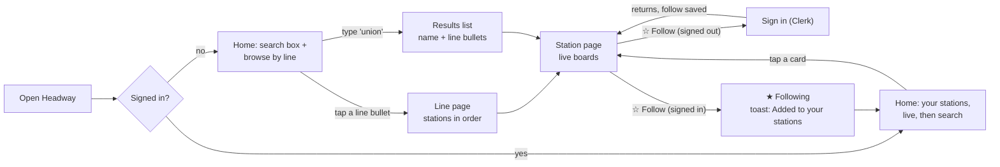

# Step 5 — Product design and UX (HEADWAY)

## Approved (2026-11-03)
* **Direction:** C, "Pocket board", combined with A's prominent countdown-style arrival numbers (large tabular monospaced minutes).
* **Visual identity:** "ink, paper, and signal".
  * Warm paper surfaces in light mode and graphite in dark mode, following the system setting.
  * Geist for UI text and Geist Mono for times.
  * MTA line colours appear only on route bullets.
  * Status colours always come with an icon and words.
* **v1 scope:** no manual reordering of followed stations. Signed-out visitors can browse every station and live times; signing in is required only to follow.

**Final design requirements that implementation must meet**

| # | Requirement | How the design meets it |
|---|---|---|
| 1 | Simple, immediately understandable; obvious controls | Two screens (Home, Station) plus a Line list. Header with wordmark and sign-in only. Every action is a labelled button. No gestures, menus, or tutorial |
| 2 | Full coverage, even at Times Sq | Every platform of a station is on its page, grouped by line, and both directions are always visible. Line chips filter to any one route. "Show N more" expands inline, so nothing is behind a swipe or a second page |
| 3 | Live vs. scheduled in explicit text | Every row carries the word "Live" or "Scheduled". The filled or outlined bullet only reinforces it |
| 4 | Search first for newcomers; your trains first for returning users | Signed out: Home opens with the search box focused-ready at the top. Signed in with follows: "Your stations" cards come first, with search below |
| 5 | Clear freshness and connection states without overwhelming | One status line per board area; only Down replaces times; Partial warns only on the affected lines; Reconnecting is a thin bar |
| 6 | Distinctive but readable, accessible, easy | Typographic identity (countdown numerals) instead of decoration; AA contrast; 44 px targets; reduced-motion respected; screen readers announce state changes, not countdown ticks |

The sections below are the exploration and rationale that led to this decision.

## 0. What the real data asks of the design
These come from the live database, not assumptions:

* **Stations vary enormously.** A typical station has 2 platforms and 1–2 lines. **Times Sq–42 St** has **10 platforms in 5 line groups and 13 routes** (1 2 3 · A C E · N Q R W · 7 7X · S). The design has to stay calm in both cases.
* **Direction labels are uneven.** "Uptown & The Bronx" and "Downtown & Brooklyn" sit next to terminal-style labels ("Queens", "34 St – Hudson Yards", "Grand Central") and a few generic fallbacks ("Northbound" on the 42 St Shuttle).
* **Schedule-only trains are common.** These are trips MTA lists before a train is dispatched: at Times Sq the 7X platform showed **5 of 5 scheduled**. Riders must be able to tell a live prediction from a timetable guess at a glance.
* **A board holds up to 12 trains** (next 3 for each route on that platform). The default view must cut that down without hiding any line.
* **Freshness is measured per feed**, so one line group can be "delayed data" while the rest of the station is live.

## 1. Three directions
The mockups shared in chat use the same real 125 St southbound data in all three.

### A · "Countdown clock": the station clock, reimagined
* **Concept and identity:** a modern take on the platform countdown clock. Near-black screen, warm amber numerals in a monospaced face, minutes as the largest thing on the page. Feels like a piece of transit hardware in your pocket.
* **Real-time communication:** each train is one row: bullet · destination · minutes, with minutes in very large tabular digits. When a prediction changes, the digit flips. Schedule-only trains get a dashed bullet, grey digits, and the word "sched".
* **Navigation:** one screen per station; a search icon in the top bar; swipe between followed stations.
* **Finding and following:** search icon → results → station; a Follow button at the bottom of the board.
* **Mobile:** excellent at arm's length. The board fills the screen and numbers read from a metre away.
* **Strengths:** instantly recognisable; the most "real-time" feeling; very glanceable.
* **Risks:**
  * Dark-only is hard to read in sunlight on elevated platforms.
  * Swipe-between-stations is hidden navigation, the "learn how it works" problem from your previous feedback.
  * Big digits for 12 trains at Times Sq means a lot of scrolling.
  * Flip animations every 15 s can feel busy.

### B · "Living line strip": routes first
* **Concept and identity:** the line, not the station, is the hero. Pick a bullet and get a vertical strip map in that line's colour, with train markers sitting between stations.
* **Real-time communication:** trains move along the strip as predictions update; your station is highlighted; "5 min away" labels sit next to the approaching trains.
* **Navigation:** home is a grid of line bullets → line strip → tap a station → its arrivals.
* **Finding and following:** browse by line, or search; follow from the station view.
* **Mobile:** a vertical strip suits phones, but long lines (the A has 66 stops) mean a lot of scrolling.
* **Strengths:** the most visually engaging; great for "where is my train?"; teaches the system.
* **Risks:**
  * **It repeats the previous feedback:** engaging but complicated, with 3 levels to reach an arrival time.
  * Most riders know their station, not their line's geometry.
  * Station complexes (Times Sq on 13 routes) don't fit a single-line view.
  * **Train positions aren't in our data.** They'd have to be inferred from many boards, which means more Realtime messages, against the backend we just built.

### C · "Pocket board": your stations as cards
* **Concept and identity:** a calm, light, paper-like interface. Each followed station is a card you keep "in your pocket", like a transit pass. Route colours carry the colour; everything else is ink and paper, so the trains stand out.
* **Real-time communication:** each card shows **the next train for each direction** in large type ("B · 2 min, then 4, 5"). The station page expands to every platform. A changed time briefly highlights its row. Scheduled trains are visibly lighter, with the word "scheduled".
* **Navigation:** two places only, **Home** (search + your stations) and a **Station** page. A Line page is just a list of stations. No menus, no tabs, no swipes.
* **Finding and following:** a search box is the first thing on Home; type "union" or "L" and pick a station. One labelled button: **☆ Follow**, which becomes **★ Following**.
* **Mobile:** single column, thumb-sized cards, a search box at the top, nothing hidden behind gestures.
* **Strengths:** the shortest path to an arrival time (open app → see your trains); obvious actions; scales from a 1-line station to Times Sq; friendly in daylight and dark mode.
* **Risks:**
  * The least "wow" out of the box; it needs a strong typographic identity so it isn't generic.
  * Cards must be compact so 4–5 followed stations fit on a phone.

## 2. Recommendation: **C, "Pocket board", with A's countdown typography**
* **It's the direct answer to your previous feedback.** Two screens, one obvious action per screen, no gestures to discover, no tutorial.
* **It's the fastest route to the core job.** Signed in, the very first screen *is* your trains. Signed out, the first thing is a search box.
* **It fits the data.** It handles both the 2-platform station and Times Sq. It shows every line without overwhelming. And it uses exactly what the worker produces (platform boards per station), with no inferred train positions.
* **It gets A's personality where it counts.** Minutes are set in large, tabular, monospaced numerals, the one element that should feel like a countdown clock, on an otherwise quiet page. B's idea survives as a simple **Line page** (an ordered list of stations), without animated positions.

**Proposed visual identity: "ink, paper, and signal"**
* **Surfaces:** warm off-white "platform tile" paper in light mode, deep graphite in dark mode (following the system setting).
* **Type:** the project's existing **Geist** for UI; **Geist Mono** with tabular figures for minutes, so digits never jiggle as they count down.
* **Colour:** only route bullets are coloured, using MTA's official line colours, which help riders recognise lines. Chrome stays neutral. Status uses a small, consistent trio: green (live), amber (late data), red (unavailable). Colour is **always paired with an icon and words**, never colour alone.
* **Motion:** one gentle highlight when a time changes, and nothing else animated.

## 3. User journey (recommended direction)

1. **First visit (signed out):** Home shows one sentence ("Live subway arrivals for every NYC station"), a search box, and a row of line bullets. No sign-in wall, so anyone can check a train immediately.
2. **Find:** type "union", "14 st", or "L"; results show the station name, borough, and line bullets. Or tap a bullet → Line page → station.
3. **See trains:** the Station page opens with live boards. Times count down every second; a time briefly highlights when it changes.
4. **Follow:** tap **☆ Follow**. If signed out, Clerk's sign-in opens; on return the follow completes automatically and the button reads **★ Following**.
5. **Return visits:** open Headway → **Your stations** is the first thing on Home, already live.

## 4. Page structure and navigation
| Page | URL | Contents (top to bottom) |
|---|---|---|
| **Home** | `/` | Header (Headway · Sign in / avatar) → **search box** → *signed in:* **Your stations** cards (live) → *signed out or empty:* short intro + **Browse by line** bullets |
| **Search results** | inline under the search box (shareable as `/?q=union`) | Up to 8 matches: name, borough, line bullets; typo-tolerant (uses the `pg_trgm` index) |
| **Station** | `/station/[id]` | Name, borough, line bullets, **☆ Follow** → freshness line → **line filter chips** (All · A · C · B · D) → one **platform board per direction**, grouped by line group |
| **Line** | `/line/[route]` | Bullet + line name → ordered station list (from `route_stops`), each row tappable |

* **Global navigation is just the header:** the "Headway" wordmark (home) on the left; Sign in or the user avatar on the right. Search lives on Home, and every other page has a search icon in the header that returns to it. **No hamburger, no tab bar.**
* The **back** button always works (real URLs, no modal-only states). The page title says where you are.

## 5. Following
* **One control in one place:** a labelled button on the Station page header. **☆ Follow** (outlined) becomes **★ Following** (filled). It's never icon-only.
* **Optimistic:** the button flips immediately and the follow is saved in the background. If saving fails, it flips back with "Couldn't save. Try again".
* **Signed out:** tapping Follow opens sign-in. The station is remembered (`?follow=611` on the return URL), so the follow completes after sign-in with no second tap.
* **Unfollow:** tap **★ Following** → it becomes **☆ Follow**, with an "Undo" toast for 5 s. On Home, each card has a small "⋯" menu with **Unfollow**, the only overflow menu in the app.
* **Limit:** at 12 followed stations the button explains: "You're following 12 stations, the maximum. Unfollow one to add another."
* **Order:** cards appear in the order you followed them. Reordering is deliberately out of scope for v1.
* **Privacy, in UI terms:** nobody else can see what you follow. This is enforced by RLS, and nothing in the UI needs to explain it.

## 6. Arrival boards
**Station page, per platform group:**
```
[A][C][E]  Downtown and Brooklyn                       ● Live
  [C]  Euclid Av                                        2 min
  [A]  Ozone Park–Lefferts Blvd                         4 min
  [E]  World Trade Center                               6 min
  ┄ show 6 more (C · A · E)
```
* **Default:** the **3 soonest** trains on that platform across all its lines. "Show more" reveals the rest, up to 3 per line, inline with no new page.
* **Line chips** (All · A · C · E …) filter the whole station page to one line, which answers "when's *my* train?" at busy stations. They're pre-selected when you arrive from a Line page.
* **Times:**
  * Under 60 s: "Arriving".
  * Otherwise: "2 min", "14 min", and "1 h 5 min" for long gaps.
  * The clock time shows small underneath on tap or hover ("12:41").
  * Times count down locally every second; the worker only sends real prediction changes.
* **Destinations:** we show where the train goes ("Euclid Av"), because riders board by destination.
* **Direction headers clean up uneven labels:** a place name becomes "To Grand Central", "Uptown & The Bronx" is kept as-is, and the generic fallback "Northbound" becomes "To *last stop*". This is display-only: a small mapping in the UI, with no backend change.
* **Live vs. scheduled (no legend needed):**
  * **Live:** filled route bullet, large bold time.
  * **Scheduled:** outlined bullet, regular-weight time, and the word "scheduled" in the row. The meaning is in the word itself, not hidden in a tooltip.
  * **Delayed data** (the feed failed twice, so the train was carried over): grey time and "last live 1 min ago".
* **Home cards:** each followed station shows **one line per direction group**, holding the soonest train ("[B] 2 min, then 4, 5"). Busy stations show up to 4 rows plus "See all 10 platforms ›".

## 7. Real-time status, in riders' words
One small status line per board area. It's never a full-screen block, except in Down.

| State | What the rider sees | Visual |
|---|---|---|
| **Loading** | Grey placeholder rows, no numbers | Skeleton shimmer |
| **Fresh** | "● Live · updated 6 s ago" | Green dot + text; seconds tick |
| **Stale** | "Last updated 2 min ago, times may be off" | Amber clock icon; times greyed but still counting |
| **Down** | "Live times aren't available right now. We'll keep trying." | Red notice in place of the board; old times hidden after 5 min. No error codes |
| **Partial** | On just the affected group: "[A][C][E] Live data delayed, last update 1 min ago" | Amber note on that group only; the rest of the station stays normal |
| **Reconnecting** | Thin bar at the top: "Reconnecting…" | Neutral, non-blocking; the board keeps its last state underneath |

* Colour never carries meaning alone; every state has an icon and plain words.
* The status line updates silently. Screen readers only announce changes **between states** (Live → Last updated…), never every countdown tick.

## 8. Terminology
| Use | Avoid |
|---|---|
| Follow / Following / Your stations | Favorite, subscribe, save, pin |
| Arriving, 2 min | ETA, prediction, 0 min |
| Live · Scheduled | Assigned, unassigned, GTFS, real-time |
| Uptown & The Bronx / To Grand Central | N, S, northbound (when a better label exists) |
| Live data delayed | Feed error, partial, carried |
| Live times aren't available right now | 500, worker failed, down |

## 9. Accessibility and mobile basics
* Tap targets of at least 44 px; body text at least 16 px; times at least 24 px.
* Contrast AA in light and dark mode.
* The countdown uses tabular figures so layout never shifts.
* Fully keyboard-operable; visible focus rings; route bullets have text labels for screen readers ("A train").
* Respects reduced-motion: no highlight animation, only a colour change.

## 10. What I need from you
1. **Choose a direction:** C (recommended), A, B, or a mix.
2. **Confirm the visual identity:** "ink, paper, and signal", Geist + Geist Mono, MTA line colours only on bullets.
3. **Confirm two scope calls:**
   * No card reordering in v1.
   * Signed-out visitors can browse and see live times; following requires sign-in.
